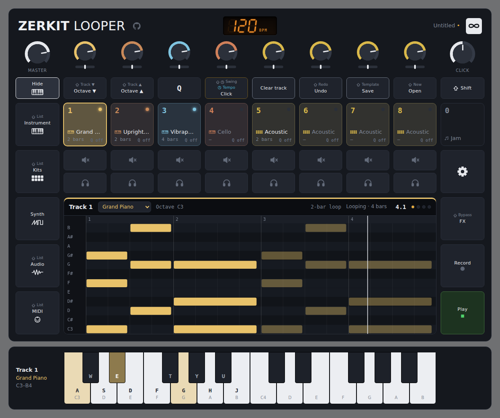
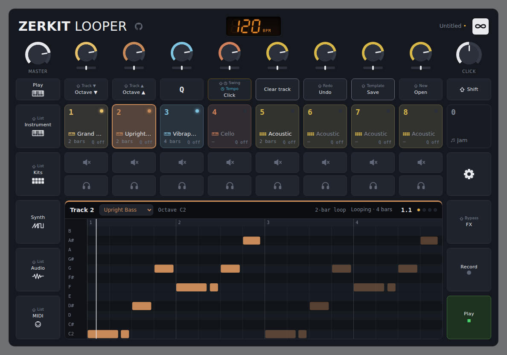
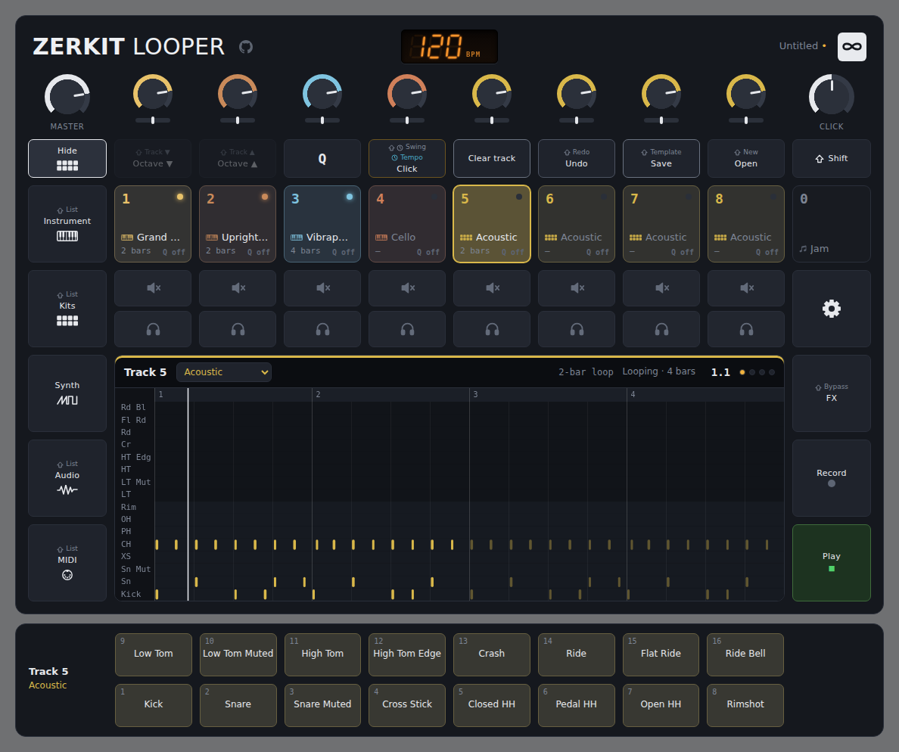
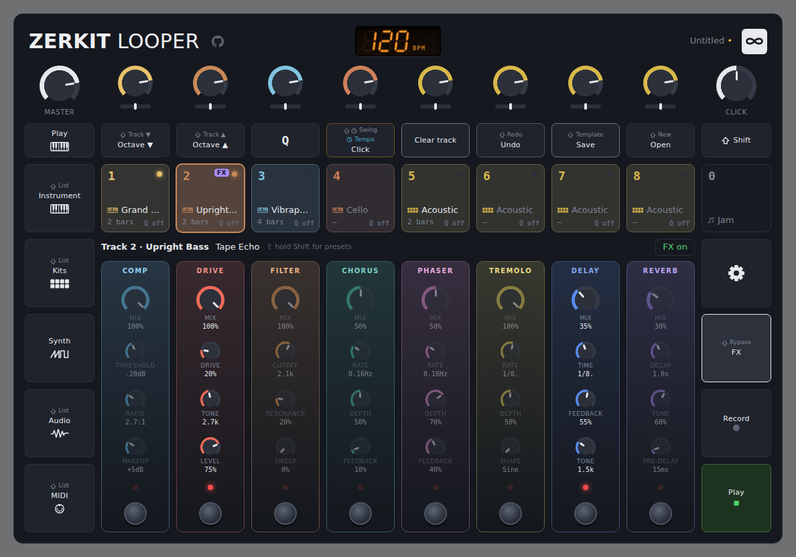
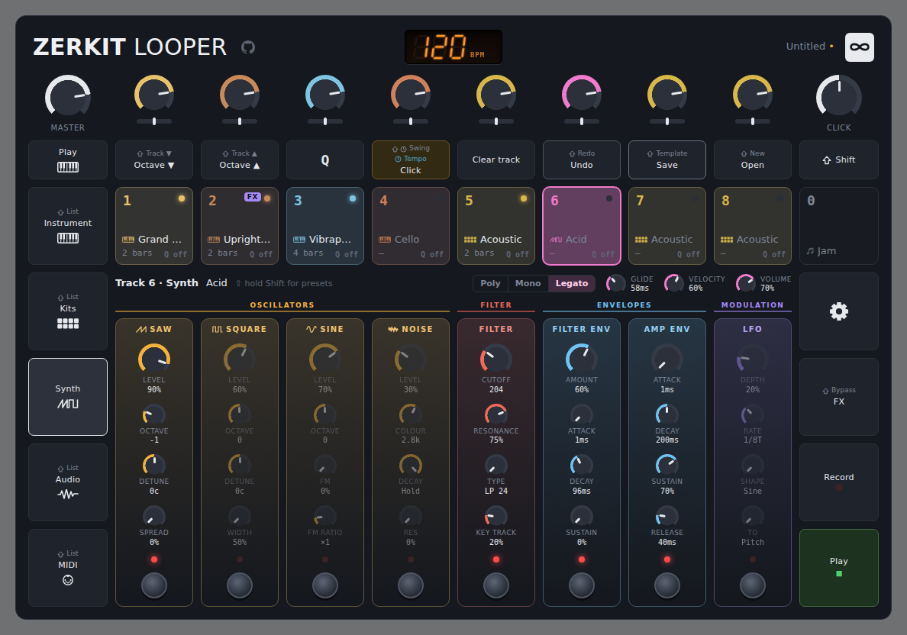
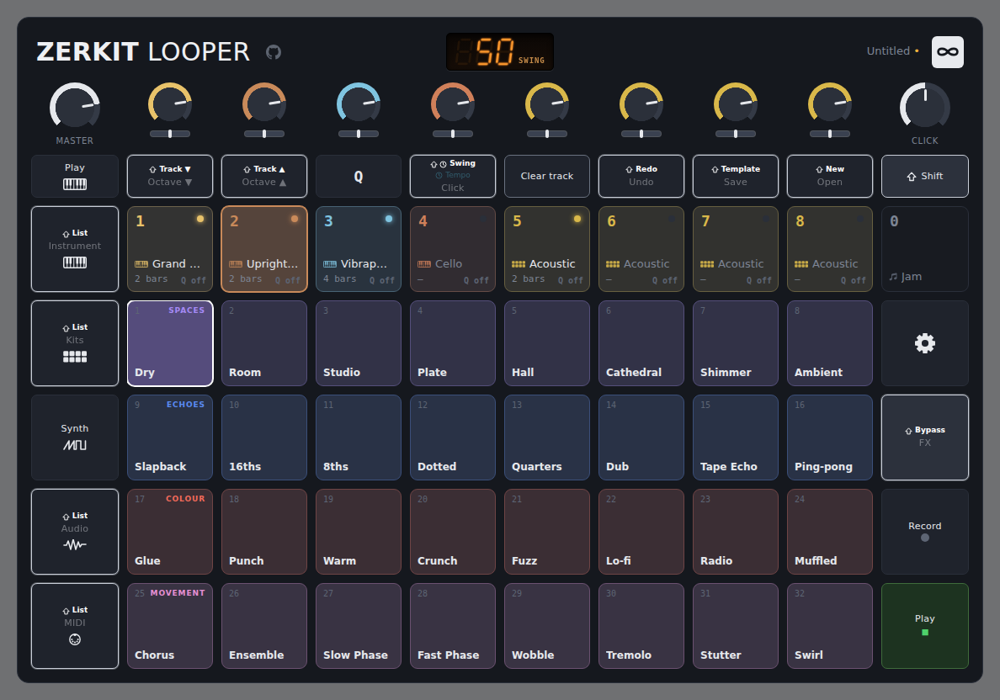

# Zerkit Looper

**An eight-track loop station that runs in your browser.** Play it from the computer keyboard, a
MIDI keyboard or a Novation Circuit Tracks, and build up loops from sampled instruments, drum kits,
a synth, live audio and external MIDI gear. Every track can have its own loop length.

**Try it: [zerkit.jonathanpincas.com](https://zerkit.jonathanpincas.com)** (desktop Chrome or Edge)



- **Loop without counting in.** Arm a track and start playing: the take starts on the bar you
  start in and closes on the bar line after you press Record again. Then overdub, undo, redo.
- **Each track keeps its own length.** A one-bar drum loop cycles eight times under an eight-bar
  bass line, all in time.
- **Five kinds of sound on every track:** sampled instruments (piano, upright bass, cello,
  vibraphone, harp, or your own), 16-pad drum kits, a subtractive synth with 32 presets, live
  audio inputs, and external MIDI instruments.
- **Make your own instruments.** The looper can sample a hardware synth note by note over MIDI
  and audio, or you can drop in your own recordings. Kits are made by dropping files onto pads.
- **Eight FX pedals per track:** compressor, drive, filter, chorus, phaser, tremolo, delay and
  reverb, plus 32 presets.
- **Mixer and timing:** volume, pan, mute and solo per track, swing, per-track record quantise,
  a metronome and tap tempo.
- **Projects are plain files**: a folder of JSON and WAV on your own computer. There's no account,
  no server and no tracking.
- **Optional hardware control surface.** With a patched firmware, a Novation Circuit Tracks
  becomes a dedicated controller for the looper, with every button, pad, knob and light mapped.

## Contents

- [Screenshots](#screenshots)
- [Getting started](#getting-started)
- [Keyboard controls](#keyboard-controls)
- [How looping works](#how-looping-works)
- [The panel](#the-panel)
- [Novation Circuit Tracks](#novation-circuit-tracks)
- [Projects and templates](#projects-and-templates)
- [Settings](#settings)
- [Sampled instruments](#sampled-instruments)
- [Kits](#kits)
- [Audio tracks](#audio-tracks)
- [MIDI tracks](#midi-tracks)
- [FX](#fx)
- [Synth tracks](#synth-tracks)
- [Development](#development)
- [Credits and licence](#credits-and-licence)

## Screenshots

| | |
| --- | --- |
|  |  |
| **Looper.** Tracks 1, 2 and 5 loop every 2 bars and track 3 every 4. The selected track's piano roll shows shorter loops repeating, faded. | **Kits.** 16 pads in General MIDI order, so a drum part moves from kit to kit. |
|  |  |
| **FX.** Eight pedals per track, one per Circuit pad column. | **Synth.** A subtractive synth per track: saw, square, sine and noise, a filter, two envelopes and an LFO. |



Hold **Shift** on the FX or Synth page for 32 presets laid out on the pads.

## Getting started

### In the browser

Open **[zerkit.jonathanpincas.com](https://zerkit.jonathanpincas.com)** in **Chrome or Edge on a
desktop computer**. The first click turns the sound on, and a 20-step guide walks you through the
panel (Esc skips it; Settings › Guide brings it back).

It needs features that only Chromium browsers have:

| Feature | Used for | Without it |
| --- | --- | --- |
| Web Audio, AudioWorklet | All sound, and audio recording | Nothing works |
| Web MIDI (with SysEx) | MIDI keyboards, MIDI instruments, the Circuit Tracks | Computer keyboard only |
| File System Access | Saving projects, kits and instruments to a folder | Projects, kits and instruments can't be saved |
| Microphone permission | Audio tracks and sampling hardware | No audio tracks |

Firefox and Safari can't save projects, so they aren't supported.

### Your first loop

1. Press **1** to select track 1 (Grand Piano).
2. Press **X** to arm it. Nothing moves yet.
3. Play something on **A S D F G H J** (white keys) and **W E T Y U** (black keys). Your first
   note starts the transport and the take.
4. Press **X** again. Recording carries on to the end of the bar, and that is the loop.
5. Press **5** for a drum track, **X**, and play the kit on the same keys (A is the kick, W the
   snare, D the closed hi-hat). Close it with **X**.
6. **Z** undoes a take, **Space** stops and starts, **⌘S** saves.

### Running it yourself

It's static files with no build step and no dependencies. It only has to be served over http,
because ES modules don't load from `file://`:

```bash
git clone https://github.com/jpincas/zerkit-looper.git
```

```bash
cd zerkit-looper && python3 tools/devserver.py
```

Then open http://localhost:8000 in Chrome. `tools/devserver.py` turns caching off, so a refresh
always gets your latest edits. `python3 -m http.server` or any other static server works too.
Web MIDI and the microphone need a secure context, which `localhost` counts as. On another host,
serve it over https.

## Keyboard controls

| Key | Action |
| --- | --- |
| `A S D F G H J` | White keys (C to B of the current octave), or the first kit pads |
| `W E` `T Y U` | Black keys |
| `,` / `.` | Octave down / up for the selected track |
| `1`–`8` | Select a track. The keyboard plays and records into the selected track |
| `0` | Jam: deselect every track, so keyboards only play themselves over the loop (pick a track to come back) |
| `Space` | Play / stop |
| `X` | Record: arm, then close the loop, then toggle overdub |
| `C` | Metronome click on/off |
| `↑` / `↓` | Tempo ±1 BPM (hold Shift for ±5) |
| `Z` / `Shift+Z` | Undo the last recording (the latest take or overdub pass, on its own track) / redo it |
| `Backspace` | Clear the selected track (`Shift+Backspace` clears everything) |
| `⌘S` / `⇧⌘S` / `⌘O` | Save / save as / open (Ctrl on Windows and Linux) |

Keys go by position (`KeyboardEvent.code`), so they're in the same place on any keyboard layout.

## How looping works

1. Select a track and press **X** (or **Record** on the Circuit) to arm it. Nothing advances until you play.
   - Your first note starts the take at the top of the bar it falls in. A note up to a 16th
     early is pulled onto the next downbeat instead.
   - If the transport is stopped, the first note also starts it, on beat 1.
2. Keep playing. The take is open-ended, so there's no length to set in advance.
3. Press **X** again. Recording carries on to the **end of the current bar**, and that is
   this track's loop length.
4. **Every track has its own length**, like Maschine. A 1-bar drum loop cycles 8 times under
   an 8-bar bass loop. Tracks keep the alignment you heard while recording them.
5. With a loop on the selected track, **X** toggles overdub, which records into it at its length.
6. **Undo** (Z, or **Duplicate** on the Circuit) removes the most recent take or overdub pass, on
   the one track it was recorded on. A track left empty loses its length.
7. **Stop** then **Play** restarts from the top of the longest loop.

**Swing** (50% straight to 75% full shuffle) delays each 8th note's second 16th as the loops
play, stretching everything in between, so it works on unquantised playing too. Audio clips and
the click aren't swung.

**Record quantise** is per track and starts off. Off keeps notes where you played them;
otherwise their starts snap to 32nds or 16ths. Notes keep the length you played, and you hear
them live exactly as played; the loop plays them on the grid from the next pass.

## The panel

There are 8 tracks, laid out like the Circuit's track buttons (Synth 1–2, MIDI 1–2, Drum 1–4).
The page is laid out like the Circuit Tracks. Top to bottom:

- **Logo row:** in the middle, a calculator-style readout of the tempo (BPM), which shows the swing
  % while Shift is held; then the project's name, and the ∞ badge, which glows green while the Circuit is
  connected (hover it for the connection's state).
- **Knobs:** Master volume (everything the looper plays) on the left, a volume knob above each
  track (with Shift: its left-right position, shown on the strip under it), and Click (the
  metronome's level) on the right. The Circuit's master volume and master filter knobs turn the
  two outer ones. Drag up/down or scroll to turn; double-click resets.
- **Row above the tracks:** Play/Hide (the play controls; the Circuit's Scales button) | Octave ▼ ▲
  (Shift: move the selected track's notes an octave), Q (cycles the selected track's record
  quantise; each track button shows its own: Q off, Q 32, Q 16), Tempo (tap: click; hold + filter
  knob or scroll: tempo; Shift: swing; shows tempo · swing), Clear track, Undo (Shift: redo), Save
  (Shift: save a template), Open (Shift: new project) | Shift (holds for the next press).
- **Track row:** Instrument (tap: the selected track's next melodic instrument, of those switched
  on; Shift: the Instruments page) | the eight track buttons | Jam, track "0" in dark grey (tap or
  `0`: deselect every track). A small icon by each track's name shows its type: keyboard
  (instrument), pads (kit), saw-and-square (synth), waveform (audio). Each track button shows its
  instrument (a synth track: its preset), loop length and activity. Click one, press `1`–`8`, or
  press its Circuit button to select it.
- **Pages:** the pad area shows the Looper, or another page. Shift + Instrument opens
  **Instruments**: every melodic instrument with a switch for whether Instrument cycles through it
  (and which tracks use it). Shift + Audio opens **Audio**, Shift + MIDI opens **MIDI**.
  Every page shows up to 16 square cards on the top two pad rows, like the Circuit's pads: tap a
  card (or its pad on the Circuit) to switch it in or out of its button's cycle; ✎ edits kits,
  audio and MIDI instruments; **＋ New** is underneath. On the Circuit, a card's pad shows the
  instrument's colour when on, dim when off, white for the selected track's own.
  Shift + Kits opens **Kits**. The same again goes back.
- **Pads:** a mute strip and a solo strip, one pad under each track, sharing the first pad row.
  Below them, filling the other three rows, the selected track's sequencer on the shared timeline
  (the longest loop), with repeats of shorter loops drawn faded. Its header shows the transport:
  what the looper is doing, the bar.beat and the beat dots.
- **Beside the pads:** the sound sources down the left, under Instrument: Kits (tap: next kit;
  Shift: the Kits page), Synth, Audio (tap: next audio instrument; Shift: the Audio page) and MIDI
  (tap: next MIDI instrument; Shift: the MIDI page). On the right: Settings (the cog), FX, Record,
  Play.

**Jam** (track 0) deselects every track, so keyboards and pads play nothing in the looper and you
can play your own instrument over the loop. Pick a track to come back.

Each button shows its actions top to bottom: what Shift does (small grey, marked ⇧), what holding
it does (small blue, marked with a clock), what a tap does (the main label), then any readout.
While Shift is held (the Shift key, the Circuit's Shift, or the on-screen Shift) the buttons with a
Shift action light up; while Tempo is held on the Circuit, its hold action lights up. Greyed-out
buttons aren't used yet.

**Play / Hide** (the Circuit's Scales button; Note mode on the Circuit) opens a playing panel under
the looper: a two-octave keyboard on instrument and MIDI tracks, or the 16-pad kit on drum tracks
(pads 1–8 along the bottom, under the eight tracks; 9–16 above). The computer keyboard plays the
first octave, or the first 12 pads.

A track plays one of five kinds of sound:

- **Instruments** (melodic, sampled): Grand Piano, Upright Bass, Cello, Vibraphone, Harp, plus your
  own. Tracks 1-4 start on Grand Piano, Upright Bass, Vibraphone and Cello. Each track remembers
  its own keyboard octave.
- **Kits**: 16 samples on 16 pads. Tracks 5-8 start on the Acoustic kit.
- **Synth**: a subtractive synth, with its own settings on each track.
- **Audio**: an audio instrument, i.e. a named audio input.
- **MIDI**: a MIDI instrument, i.e. an external instrument played over MIDI.

Kit pads are in playing order: Kick, Snare, Clap, Rim, Closed hat, Pedal hat, Open hat, Snare 2
along the bottom; four toms, Crash, Ride, Tambourine, Cowbell above. Each plays its General MIDI
note, so a part played in from a MIDI drum kit lands on the right sounds; other notes fold onto
the GM octave from C1.

The address keeps what's on screen: the selected track, the open page and the play controls
(`#3/fx`, `#1/settings/midi`, `#0` for Jam, `/keys` with the play controls shown), so a refresh
comes back to the same view.

## Novation Circuit Tracks

The looper can use a [Novation Circuit Tracks](https://novationmusic.com/products/circuit-tracks)
as a dedicated control surface. A patched firmware switches off the Circuit's own sequencer,
sounds and screens. Every button, pad and knob goes to the looper over USB, and the looper sets
every light. The Circuit's own track buttons, pads and knobs then do the jobs they're named for.

> [!CAUTION]
> **Use the patched firmware entirely at your own risk. I take no responsibility for anything
> that happens to your Circuit Tracks**: damage, a device that won't start, lost projects or
> samples, or anything else. Modified firmware is not made, supported or approved by Novation,
> and installing it **will probably void your warranty**. If you aren't comfortable with that,
> don't install it. The rest of the looper works without it.
>
> For what it's worth: the Circuit's bootloader isn't part of the firmware image and is never
> touched, so you should always be able to go back to Novation's official firmware from recovery
> mode (see below). But there are no guarantees.

### Building the firmware

Novation's firmware is proprietary, so this repository holds **no firmware**, official or
patched. You download Novation's official file yourself and the patch builder in `circuit/` makes
the looper firmware from it on your own computer. The result is byte-for-byte reproducible.

1. Download the official **Circuit Tracks 1.2.1 (build 4486)** firmware from Novation Components:
   [circuittracks-firmware-4486.syx](https://components.novationmusic.com/api/v2/firmwares/168/file).
   Save it as `circuit/incoming/circuittracks-firmware-4486.syx`. Its SHA-256 must be
   `bd2d294bafa88fdec7ae1f5fcaaa13158323969c5a40f83405a72e4ad329a0bd`. The builder refuses any
   other file.
2. Install the disassembler the builder uses to check its patches:

   ```bash
   cd circuit && python3 -m venv .venv && .venv/bin/pip install -r requirements.txt
   ```

3. Build LOOP06, the current looper firmware:

   ```bash
   .venv/bin/python build_lights.py incoming/circuittracks-firmware-4486.syx --splash
   ```

   It writes `circuit/build/circuittracks-4486-LOOP06.syx` with SHA-256
   `562f9f39b37345a9f32adc86f7d407efbf1df4edb1fb797bc10ec01a957241bc`. The looper only installs
   a file with exactly that hash.

`circuit/test_*.py` run the patched code in an ARM emulator (Unicorn), so the patches can be
checked without a Circuit. How it works, the protocol and the button ids are in
[docs/circuit-protocol.md](docs/circuit-protocol.md).

### Installing it

Because the files stay on your computer, run the looper locally to install firmware (see
[Running it yourself](#running-it-yourself)).

1. Switch the Circuit off. Hold **Scales + Preset + Note** while switching it on. That's recovery
   mode.
2. In the looper, open **Settings** (the cog) › **Firmware**, then **Check Circuit**.
3. Pick **Zerkit (LOOP06)**, press **Send**, and press **Play** on the Circuit when asked.

To go back to Novation's firmware, do the same and pick **Novation 1.2.1**.

After switching on, "LOOP" scrolls across the pads until the looper connects.

### What the Circuit does

| Circuit | Looper |
| --- | --- |
| Play / Record | Play-stop / record (arm, close, overdub) |
| Clear | Clear the selected track |
| Duplicate / Shift + Duplicate | Undo the last recording / redo it |
| Track buttons (Synth 1 … Drum 4) | Select tracks 1–8 |
| Preset / Shift + Preset | The selected track's next instrument (of those switched on) / Instruments page on and off |
| Note / Shift + Note | The selected track's next kit (of those switched on) / Kits page on and off |
| Velocity | Make the selected track a synth track and show its synth / on a synth track: Synth page on and off (knob: a column's main control; hold pad 1-3 + knob: its controls; bottom pad: on/off; Shift + pad: one of 32 presets) |
| Gate / Shift + Gate | The selected track's next audio instrument / Audio page on and off |
| Pattern Settings / Shift + Pattern Settings | The selected track's next MIDI instrument / MIDI page on and off |
| Patterns | Jam (its light amber while jamming) |
| Octave ▼ ▲ / Shift + Octave ▼ ▲ | Keyboard octave / move the selected track's notes an octave (instrument and MIDI tracks) |
| Tempo/Swing: tap | Click on/off |
| Hold Tempo/Swing + turn the master filter knob | Tempo (with Shift held too: swing) |
| Macro knob above each track / with Shift | That track's volume / left-right position |
| Scales | Switch between track view and Note mode (and the play controls on screen) |
| FX / Shift + FX | The selected track's 8 FX pedals (knob: a pedal's mix; hold pad 1-3 + knob: its controls; bottom pad: footswitch; Shift + pad: one of 32 presets) / bypass them |
| 1-16/17-32 | Cycle the selected track's record quantise (its light: red off, amber 32nds, green 16ths) |
| Save / Shift + Save | Save the project / save a template |
| Projects / Shift + Projects | Open a recent project / new project (both on screen; Play picks) |
| Mixer | Settings on and off (track buttons: its page; Octave ▲ ▼ or the master filter knob: choose; Play: pick; Clear: delete) |
| Master volume knob | Master volume |
| Master filter knob | Click level (hold Tempo: tempo; Shift too: swing) |

**Track view** (default):

| Pads | Looper |
| --- | --- |
| Row 1 | Mute each track (red = muted) |
| Row 2 | Solo each track (green = soloed; several can be soloed) |
| Rows 3–4 | 16-step view of the selected track: the bar the playhead is in, notes in the track colour |

**Note mode** on an instrument or MIDI track: all 32 pads are a two-octave keyboard with velocity.
Rows 1–2 are the upper octave and rows 3–4 the lower; in each pair, black keys are above white
keys. On a drum track: rows 1–2 stay mute and solo, rows 3–4 are the 16-pad kit, laid out as on
screen. Track buttons still select tracks.

## Projects and templates

**Save** (⌘S) the first time asks for a name, then saves straight away every time after, with a
brief "Saved" notice. ⇧⌘S saves under a new name. **Open** (⌘O) lists recent projects, newest
first (↑ ↓ and Enter, or click). Opening warns first if there are unsaved changes. The looper
reopens the last project you saved or opened (as last saved) when the page loads. If Chrome wants
a click before it lets the page back into the projects folder, the notice at the bottom says so
and the first click reopens it. Starting a new project forgets it. The current project's name is
in the logo row, with • while there are unsaved changes (Save's border brightens, and its light on
the Circuit is white).

Projects live in a folder on your computer, chosen the first time you save (Chrome asks for
permission to use it; choose "Allow on every visit", or it asks again after a reload). Each
project is a folder:

    My Song.zerkit/
      project.json      tempo, swing, tracks (instrument, octave, quantise, volume, pan, mute,
                        solo, loop, notes), audio instruments with their inputs, which instruments,
                        kits and audio instruments are switched off
      audio/*.wav       one 32-bit float WAV per recorded take or overdub layer

Saving from the Circuit works once the folder has been allowed in this session (a click on the
page is needed for that; a Circuit button doesn't count).

**Templates** are a project's setup without its recordings: tempo, swing, each track's sound,
octave, quantise, mix, FX and synth, and which instruments each button cycles through.
**⇧ Save** keeps the current setup as a template under a name. **⇧ Open** is New project: it
lists the stock setup and your templates, starting on the default, so ⇧ Open then Play (or
Enter) starts a new project. With unsaved changes it first asks: Save current (chosen to start
with; a project never saved asks for a name) or Continue without saving. One template can be the
**default**: the looper starts with it when it loads. Without one, it's the stock setup.
Templates are kept in this browser, so they're there straight away.

## Settings

**Settings** (the cog, right of the pads; Mixer on the Circuit) fills the pad area, and the track
buttons pick its page. Inside it ▲ ▼ (the Octave buttons, arrow keys or the master filter knob)
choose a row, Play (Enter) does the row's thing, Clear track (⌫; Clear on the Circuit) deletes it
on the second press. On the Circuit each row is also a pad (amber: the default).

- **Templates** (track 1): the stock setup and your templates. Play makes the chosen one the
  default (again: back to the stock setup).
- **MIDI** (track 2): which MIDI input plays the selected track, like the computer keyboard or
  the Circuit's pads: all inputs or one (row 1), on every channel (Omni, row 2) or one (rows
  3–4: 1–16). Laid out like the pads, so on the Circuit a pad picks it. Kept in this browser.
  A MIDI instrument with its own keyboard still hears that keyboard whatever's picked here.
- **Firmware** (track 3): puts the looper's firmware on the Circuit, or Novation's official
  firmware back (see [Installing it](#installing-it)).
- **Monitor** (track 4): every MIDI message coming in, newest first, the Circuit's controls
  included. Ones the looper doesn't play are dimmed, with why (e.g. not the MIDI input or
  channel picked). Clear track empties it.
- **Guide** (track 5): start the guide over, continue it from where you left it, and whether it
  shows on startup.

The **guide** is a click-through of the panel in 20 short steps: each opens what it's about (the
Instruments list, the keyboard, FX, the synth, Jam, Settings), dims the rest, outlines the part and
says what it does, and which Circuit button does it. Next and Back (→ ←, Enter), Esc or ✕ to
close, which puts the screen back as it was; nothing in the project is changed. It shows on
startup, carrying on from the step you reached, until you finish it or tick "Don't show on
startup".

## Sampled instruments

A sampled instrument is recorded notes spread across the keyboard: each key plays the nearest
recording in its velocity layer, re-pitched, with a natural release. Samples load the first time
an instrument is used. Five come built in (see [instruments/README.md](instruments/README.md)).

Make your own on the Instruments page (Shift + Instrument): **＋ New instrument** opens the maker.

- **Sample a hardware instrument:** choose a MIDI instrument to play (e.g. your Moog) and an audio
  instrument to record it through, set the range and how it's sampled, and press **Sample** (Play
  on the Circuit). It plays each note, records it, trims it to its attack and tail, and matches
  levels across the instrument (keeping its dynamics). Stop at any time.
- **Or drop audio files** on the maker: each one's note comes from its name ("Piano_C4.wav",
  "Moog A#2").
- The eight settings are the Circuit's knobs 1-8: Low note, High note, Every (semitones), Layers
  (velocities 1-3), Note length, Tail, Release, Octave (the keyboard's starting octave). Click a
  sampled note to hear it, ✕ to remove it. **Save** (Record on the Circuit) names and keeps it.

Your instruments are kept in the projects folder, in `Instruments/` (`My Moog.zinst/instrument.json`
and `samples/*.wav`); ✎ on its card edits one.

## Kits

A kit is 16 samples on the 16 kit pads, played the same way on screen and on the Circuit, with
the same GM notes, so a drum part can move from kit to kit.

On the Kits page (Shift + Kits), **＋ New kit** opens the editor: drop audio files (WAV, AIFF,
MP3, M4A, FLAC) onto pads (several at once fill the empty pads after it), click a pad to hear it,
drag a pad onto another to swap them, ✕ to clear one, name it and **Save kit**. Click a kit to
edit it (saving under a new name makes a copy). Each kit's switch says whether **Kits** (tap)
cycles through it; the switches are saved with the project. Kits are also in the instrument menu.

Five kits come built in: **Rock, Pop, Jazz** (brushes), **Acoustic** and **Percussion**, made
from free CC0 sample libraries (see [kits/README.md](kits/README.md)). Editing a built-in kit and
saving it makes your own copy.

Your own kits are kept in the projects folder, in `Kits/`, one folder each with its samples copied
in (`My Kit.zkit/kit.json` and `samples/`), so moving or deleting the original files doesn't
matter. A project refers to its kits by name.

## Audio tracks

An **audio instrument** is a named audio input, for example "CP88" for a stage piano's USB audio.
Make them on the Audio page (Shift + Audio, the Circuit's Gate button): **＋ New audio**, a name
and an input. They're kept on this computer (inputs belong to the machine); projects remember each
one's name and input, so opening a project elsewhere makes the ones it needs. **Audio** (tap)
cycles the selected track through the ones switched on; choosing one connects the track to its
input.

Arm with X: the take starts on the first sound and closes on a bar line like any other, and plays
back through the computer's audio output with its own loop length, mute, solo, volume and undo.
Recordings are shifted back by the input's latency so they sit on the beat. Once a track holds
audio the tempo is locked. Overdubbing (X on a track with a loop) adds a layer, which undo can
take off again.

## MIDI tracks

A **MIDI instrument** is an external instrument played over MIDI: a name, an **output** (a MIDI
port and channel) and optionally an **input** (the keyboard that plays it; any keyboard if not
set). Make them on the MIDI page (Shift + MIDI, the Circuit's Pattern Settings button). A MIDI
track records notes like any other and sends them, live and looped, to its output, timed to line
up with the browser's audio; mute and solo apply, and the track's volume scales velocity. If the
same instrument is both input and output, turn its Local Control off so it doesn't sound twice.
Like audio instruments they're kept on this computer and projects remember their settings.

## FX

Every track has a pedalboard of 8 pedals in a row, between its volume and its left-right
position, one per Circuit pad column:

| Column | Pedal | Controls (hold pad 1 / 2 / 3 of the column and turn its knob) |
| --- | --- | --- |
| 1 | Comp | Threshold, Ratio, Makeup |
| 2 | Drive | Drive, Tone, Level |
| 3 | Filter | Cutoff, Resonance, Sweep (a half-note wobble) |
| 4 | Chorus | Rate, Depth, Feedback |
| 5 | Phaser | Rate, Depth, Feedback |
| 6 | Tremolo | Rate (synced), Depth, Shape (sine or square) |
| 7 | Delay | Time (synced; ping-pong), Feedback, Tone |
| 8 | Reverb | Decay, Tone, Pre-delay |

**FX** (the Circuit's FX button) opens the selected track's. On the Circuit, a column's knob on its
own turns that pedal's **Mix**; hold pad 1, 2 or 3 of the column and turn it for that control;
the column's bottom pad is the **footswitch**. Pads show each pedal's colour when it's on (a
held pad white); knob lights show what each knob is turning. On screen each pedal is its Mix knob,
three controls and a footswitch.

**Presets:** hold **Shift** (on the Circuit, the Shift key, or on-screen Shift) and the pedals
give way to 32 presets in a 4 x 8 grid lying on the pads; press one (pad n = preset n) to load it.
One row per kind: Spaces (Dry, Room, Studio, Plate, Hall, Cathedral, Shimmer, Ambient), Echoes
(Slapback, 16ths, 8ths, Dotted, Quarters, Dub, Tape Echo, Ping-pong), Colour (Glue, Punch, Warm,
Crunch, Fuzz, Lo-fi, Radio, Muffled), Movement (Chorus, Ensemble, Slow Phase, Fast Phase, Wobble,
Tremolo, Stutter, Swirl). The loaded one is white. Turning a pedal's control switches it on.
**⇧ Bypass** switches the track's FX off and on; a purple FX badge on the track shows when a
pedal is on. A pedal's audio is only made the first time it's switched on. Each track's FX is
saved with the project.

## Synth tracks

**Synth** (the Circuit's Velocity button) makes the selected track a synth track and opens its
synth; on a synth track it opens and closes the Synth page. Every track has its own synth
settings, so eight synth tracks can sound completely different; they're saved with the project
(kept even while a track plays something else). It's made of Web Audio nodes, like the FX, laid
out left to right like a synth panel, one column per Circuit pad column:

| Column | Main knob | Controls (hold pad 1 / 2 / 3 of the column and turn its knob) |
| --- | --- | --- |
| 1 Saw | Level | Octave, Detune, Spread (a detuned stack: supersaw) |
| 2 Square | Level | Octave, Detune, Width (pulse width) |
| 3 Sine | Level | Octave, FM (bells, e-pianos), FM ratio |
| 4 Noise | Level | Colour, Decay (or Hold), Res |
| 5 Filter | Cutoff | Resonance, Type (LP 24, LP 12, BP, HP), Key track |
| 6 Filter env | Amount | Attack, Decay, Sustain (releases with the amp) |
| 7 Amp env | Attack | Decay, Sustain, Release (off: a plain gate) |
| 8 LFO | Depth | Rate (synced), Shape, To (pitch, filter or amp) |

The bottom pad (or the round switch on screen) switches a column on and off; turning one of its
controls switches it on. The header has the voice settings: **Poly / Mono / Legato** (legato
doesn't restart the envelopes for a note played while another is held; letting go goes back to a
key still down), **Glide**, **Velocity** (how much velocity sets loudness and the filter
envelope's depth) and **Volume**. Turning a control changes notes already sounding.

**Presets:** hold **Shift** for 32 presets in a 4 x 8 grid lying on the pads, a row each:
Leads (Classic, Supersaw, Square Lead, Brass, Whistle, Screamer, Chip, Fat Lead), Bass (Sub Bass,
Saw Bass, Acid, Reese, Pulse Bass, Wobble, FM Bass, Fat Bass), Pads (Warm Pad, Dream Pad, Strings,
Organ, Choir, Glass Pad, Dark Pad, Sweep) and Plucks (Pluck, E-Piano, Bell, Marimba, Harp, Clav,
Kalimba, Stab). New synth tracks start on Classic.

## Development

Plain JavaScript ES modules, HTML and CSS: no framework, no bundler, no npm. Edit a file and
refresh.

```
index.html, styles.css   the page
src/                     the app
instruments/, kits/      built-in samples (CC0), with their index.json files
tools/                   dev server, and the scripts that build the built-in samples
circuit/                 Circuit Tracks firmware patch builders and their emulator tests
docs/                    the Circuit protocol, MIDI notes, screenshots
```

- `src/engine.js`: transport, record state machine and lookahead scheduler. It's pure logic
  that talks to an `out` interface.
- `src/audio.js`: the Web Audio implementation of `out`. It routes each track to its instrument
  and plays the click.
- `src/instruments.js`: the instrument registry and the kit pad layout; `src/audioinst.js` /
  `src/midiinst.js`: audio and MIDI instruments and their pages; `src/cards.js`: the square
  cards every page uses; `src/fx.js` / `src/fxpage.js`: the per-track pedals, and the FX page;
  `src/synth.js` / `src/synthpage.js`: the per-track synth, and the Synth page.
- `src/projects.js`: the projects folder and the project files; `src/session.js`: the current
  project (saving, opening, new, templates) and its screens; `src/templates.js`: template
  storage; `src/settings.js`: the Settings pages (`src/firmware.js`: Firmware,
  `src/monitor.js`: Monitor, `src/tour.js`: the guide).
- `src/kits.js`: sample kits (storage, and each kit as an instrument); `src/kitpage.js`: the Kits
  page and kit editor.
- `src/sampler.js`: sampled instruments (zones, playback, storage); `src/instpage.js`: the
  Instruments page and the instrument maker.
- `src/circuit.js`: the Circuit Tracks control surface; `src/midiin.js`: MIDI inputs.
- `src/roll.js`: canvas piano roll (one per track).
- `src/keys.js`: computer-keyboard note mapping.
- `src/audioin.js`, `src/capture-worklet.js`: audio inputs, captured continuously so takes can be
  cut out of them.
- `src/main.js`: wiring, shortcuts and the render loop. `window.looper` exposes the app in the
  console for debugging.

**Rebuilding the built-in samples** (needs `ffmpeg`; downloads the source libraries into a cache
folder that git ignores):

```bash
python3 tools/build_kits.py
```

```bash
python3 tools/build_instruments.py
```

More notes: [docs/circuit-protocol.md](docs/circuit-protocol.md) (the control-surface protocol
and firmware patches), [docs/circuit-tracks-midi.md](docs/circuit-tracks-midi.md) (what a stock
Circuit Tracks sends over MIDI), [docs/cp88-midi.md](docs/cp88-midi.md) (a retired experiment
with a Yamaha CP88).

Issues and pull requests are welcome.

## Credits and licence

The code is under the [MIT licence](LICENSE).

The built-in kits and instruments come from sample libraries by **Karoryfer Samples** and
**Versilian Studios** (Big Rusty Drums, Swirly Drums, Virtuosity Drums, VCSL, Osiris Piano,
Meatbass, and Cello with Bigcat), all released under CC0 1.0. The Circuit Tracks firmware work
builds on research by the [CIRCUIT-HACKS-RC](https://github.com/Ghillermo/CIRCUIT-HACKS-RC)
project. Details are in [NOTICE.md](NOTICE.md).

Novation, Circuit Tracks and Components are trademarks of Focusrite Audio Engineering Ltd. CP88 is
a trademark of Yamaha Corporation. Zerkit Looper is an independent project, not affiliated with or
endorsed by either company.
